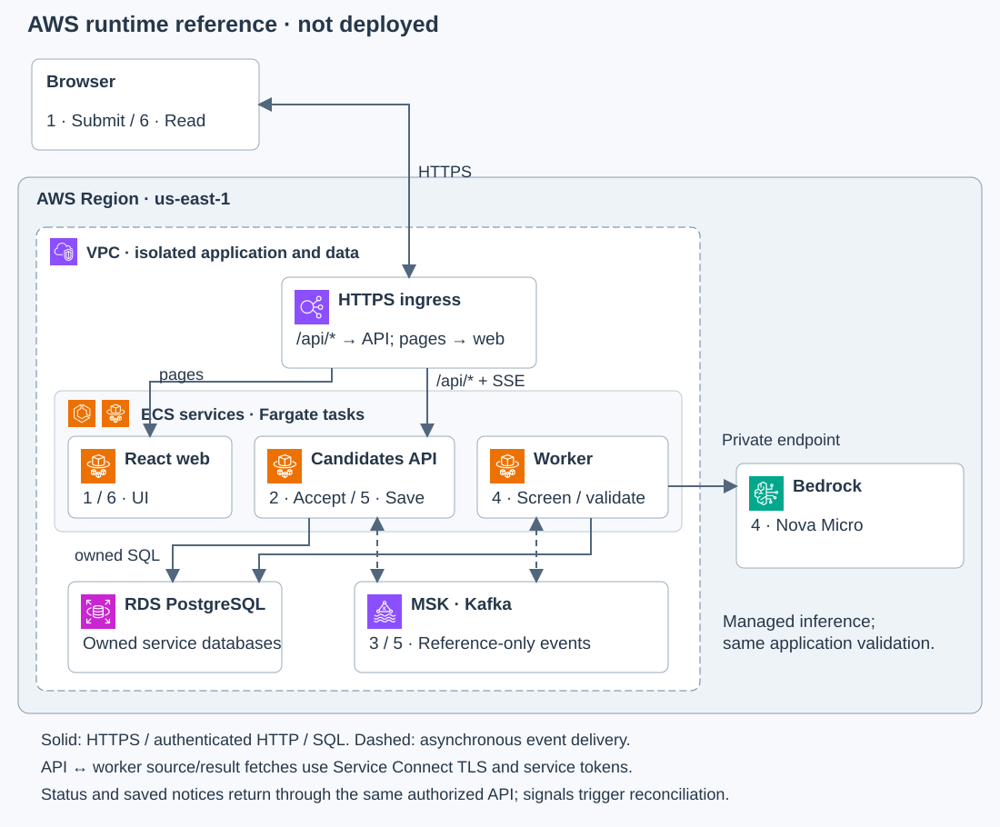
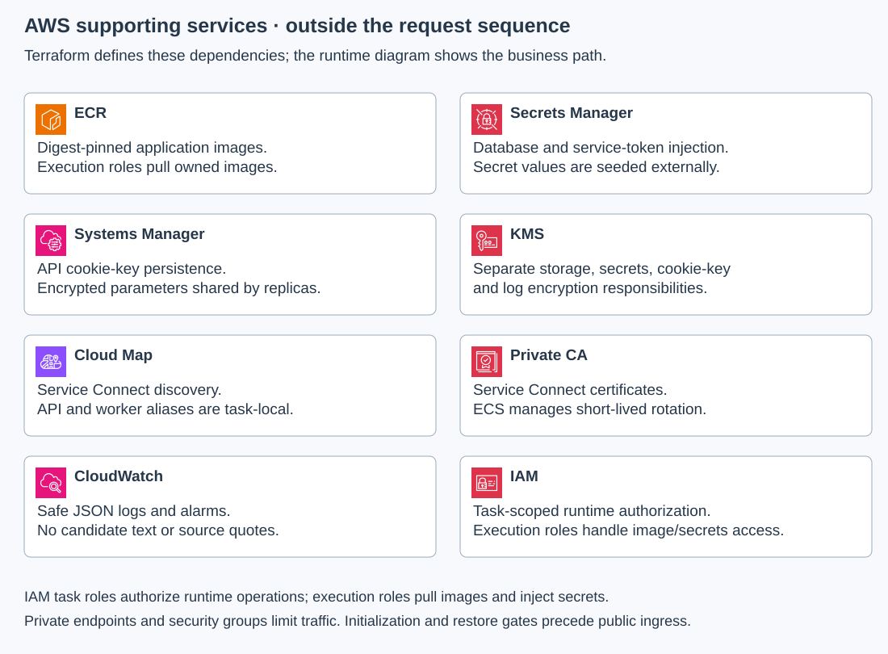

# AWS deployment architecture

The AWS reference preserves the local submission, screening and result flow. Terraform defines a private runtime with explicit service identities and deployment gates. It has not been deployed; local execution and configuration checks do not establish managed-service behavior.

## The same screening journey

1. **Submit.** React is served by its own Fargate service. An HTTPS Application Load Balancer routes `/api/*` directly to the Candidates API and application pages to the web service. Internal operations are excluded from public routing.
2. **Accept.** The API validates the protected browser session, antiforgery token, retry key and input. It commits candidate state and an outbox in its owned PostgreSQL database before returning an acceptance receipt.
3. **Publish.** The relay publishes a reference-only event through MSK with IAM authentication and encrypted transport. Broker acknowledgment precedes marking the outbox delivered; ambiguous failure can repeat delivery.
4. **Screen.** The worker fetches source through authenticated internal HTTP, invokes regional Nova Micro through Bedrock Converse and applies the same evidence validation as the local provider. It commits its inbox, result and completion outbox in its separate database.
5. **Save.** The API consumes completion, fetches the result through the worker's internal endpoint and saves visible state and one durable notification. Service Connect proxies encrypt cross-task HTTP; service tokens remain mandatory.
6. **Read.** Each API replica consumes change wakeups for its own browser streams. An authorized signal prompts React to reconcile persisted state. Background completion leaves unrelated navigation and drafts intact; reopening the browser retrieves saved notices.

An evidence gap is a review result; an unavailable provider is a technical failure. Neither local nor managed inference makes a hiring decision. Retried events preserve their identity and must not recreate deleted or expired records.

## Supporting services

These dependencies support startup, authorization and operations. They are not extra sequential hops for every request.

| Responsibility | Local execution | AWS reference and material difference |
| --- | --- | --- |
| Ingress and compute | Same-origin Nginx, Candidates API and worker containers | ALB and separate ECS/Fargate services; cloud routing and task lifecycle need live checks. |
| Durable application state | Separate PostgreSQL databases and roles | Encrypted RDS PostgreSQL with separate owned databases, protected backups and hostname-verified TLS. Local volumes do not demonstrate RDS recovery. |
| Event handoff | Private single-broker Kafka | Private MSK with IAM, encrypted transport and replicated topics. Local execution does not demonstrate managed availability or IAM. |
| Evidence generation | Ollama chat with a JSON Schema | Bedrock Converse with Nova Micro. This model has no native structured-output guarantee; shared application validation remains authoritative. |
| Runtime identity | Local service token and distinct database roles | Scoped IAM task roles plus service tokens and database roles. Execution roles separately pull images and inject secrets. |
| Configuration and secrets | Ignored local credential files; persisted cookie-key volume | Secrets Manager injection and encrypted SSM cookie-key parameters. Terraform creates secret descriptors, never secret values. |
| Encryption | Local network isolation and protected files | KMS keys, RDS/MSK encryption and Service Connect TLS backed by Private CA. Local checks do not establish managed key/certificate behavior. |
| Discovery | Compose service names | Service Connect aliases and Cloud Map. Endpoint membership requires the explicit deployment/redeployment sequence. |
| Images | Local reviewed builds | ECR images selected by digest; publishing images is a separate operator action. |
| Telemetry | OpenTelemetry Collector and OpenObserve | Safe JSON logs and operational alarms in CloudWatch. External alert delivery is not configured. |

Private subnets have no internet route. Declared private endpoints supply the selected AWS APIs; an S3 gateway supports ECR image-layer downloads and is not candidate-document storage. This feature accepts text rather than uploaded files.

## Deployment and recovery boundaries

The [Terraform runbook](../infra/terraform/README.md) describes account prerequisites, image publication, external secret seeding, the one-shot database/topic initializer, Service Connect discovery and public-ingress activation. Public traffic remains in maintenance until initialization and runtime checks succeed. Resource ordering alone does not prove endpoint discovery or successful bootstrap.

Active source, results and notices expire after seven days; owners may delete sooner. Encrypted backups age out separately. Restored services must reconcile expiry, later owner deletions and event state before accepting traffic. An older snapshot cannot reveal deletions made after it was taken. No live AWS restore has been exercised.

Data, keys, registries, secrets, logs and certificate authority resources have destruction protections. Retirement needs a deliberate data-preservation and dependency-draining procedure; the reference provides no automatic destructive teardown.

See [the local design](design.md), [the provider decision](decisions/0002-ai-provider-boundary.md) and [Terraform source](../infra/terraform/).
