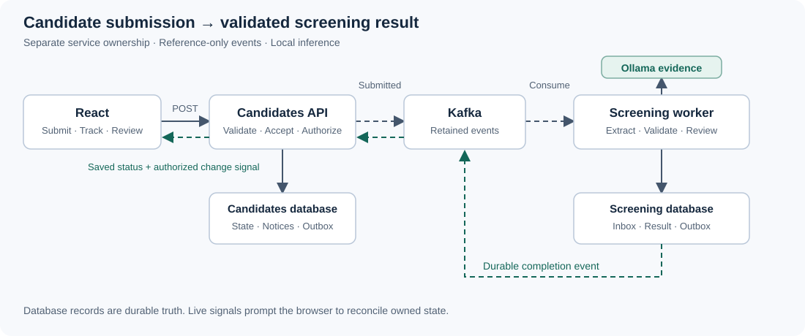

# Candidate submission and screening

The proposed architecture separates durable candidate acceptance from asynchronous AI-assisted screening. Synthetic profile narratives and explicit job requirements are the source material. The model extracts evidence; server rules validate it and produce an explainable result for human review. The complete application flow is not yet verified.

## Request to result

1. **Submission.** React sends bounded JSON with an owner-scoped idempotency key and antiforgery token. Client validation supports the form; server validation is authoritative.
2. **Acceptance.** The Candidates API derives ownership from a protected cookie, validates the request and commits candidate state plus a submission outbox in the same transaction. It then returns `202` and a status identifier. The processing route leaves navigation available.
3. **Publication.** A relay claims due outbox records under recoverable leases, publishes to Kafka and marks delivery only after broker confirmation. Ambiguous failure can cause repeat publication.
4. **Screening.** The worker validates the event and deduplicates its identity. Inference runs outside database transactions. Structured output and exact source evidence pass application validation before deterministic scoring. The worker atomically commits its inbox, result and completion outbox before advancing the consumer offset.
5. **Completion.** A completion consumer in the Candidates API atomically updates status, a durable notification and a change outbox. It does not read the worker's database.
6. **Browser update.** Change events wake owner-authorized streams. React fetches changed state and shows the result or a saved notification. Reconnect and reload reconcile persisted state; live signals are not the source of truth.

`Accepted` means stored work. Proposed visible states are `Queued`, `Screening`, `Completed` and `Failed`. Infrastructure failure is distinct from an evidence gap.

The [detailed overview](assets/overview.svg) and [editable diagram](assets/overview.mmd) show the corresponding service interactions. Solid arrows are synchronous operations; dotted arrows are asynchronous delivery.

## Service ownership

| Component | Owns |
| --- | --- |
| Candidates API | Admission, request idempotency, owner authorization, candidate status, notifications and browser updates |
| Screening worker | Event inbox, AI evidence validation, scoring rules, results and completion outbox |
| Shared contracts | Versioned event shapes and mechanical transport utilities; no shared business database |
| Kafka | Retained event delivery and consumer offsets; not authoritative application state |
| PostgreSQL | Separate Candidates and Screening databases with separate service roles |
| React and same-origin proxy | Form, processing, result and notification routes; authorized event-stream connection |
| Ollama | Local evidence extraction through a narrow provider contract |

## Events and committed effects

| Event | Producer → consumer | Effect |
| --- | --- | --- |
| `candidate-submitted` | Candidates outbox → Screening worker | Validate synthetic input, extract evidence and commit a unique result |
| `screening-completed` | Screening outbox → Candidates API | Commit terminal status and a stable owner-scoped notification |
| `candidate-changed` | Candidates outbox → API stream handlers | Signal that authorized state should be fetched |

Events carry a version, stable event identity and candidate identity. Submitted events contain only the bounded synthetic input needed for screening; change signals carry no narrative. Partition keys preserve candidate ordering within a partition. Inbox and result constraints prevent duplicate committed effects; the transport remains at-least-once.

HTTP retries bind owner, key and canonical input. Unchanged-input retries return the original acceptance; conflicting reuse is rejected. No database transaction remains open during inference or an idle browser stream.

## Delivery and recovery

Relays use broker confirmation, leases and bounded retries. Consumers commit offsets after durable application effects. Invalid records enter durable poison handling; exhausted valid work produces a visible failure rather than fabricated evidence. Operator recovery can requeue a durable failed handoff without discarding its identity.

An API replica receives change wakeups for its own authenticated browser channels. Subscribe before database catch-up, then drain queued wakeups to close the delivery race. Slow readers disconnect and reconcile; idle streams hold no database connection. Completion on the currently viewed candidate may open its result. Completion elsewhere adds an explicit link without redirecting or moving focus. Closing the browser does not cancel accepted work.

Ordinary process restarts preserve database and broker volumes. Local services share failure domains; persistence alone does not establish backup restoration or deployment failover. Lifecycle changes must fence late events so removed candidates cannot be recreated by old completions.

## Trust boundaries

Validate shape, size, identifiers and version at HTTP, broker and provider boundaries. Use parameterized SQL, explicit transactions and unique constraints. Bound admission, messages, queues, retries and inference; honor cancellation and leave unfinished durable work recoverable during shutdown.

Narratives and model output are untrusted data. Evidence must reference an allowed requirement and an exact source snippet. A matching quote alone does not establish a positive claim: negation and irrelevant mentions require explicit validation cases. The model receives no tool access and makes no hiring decision.

Protected cookie identity isolates synthetic browser sessions; it is not production SSO. Persist Data Protection keys for restart compatibility. Validate antiforgery tokens on state-changing requests and authorize every status, result, notification, acknowledgement and stream by server-derived owner. Session changes close streams and fence stale responses. Deployment requires TLS and appropriate cookie, host and security-header configuration.

Logs allow safe identifiers, event categories and state transitions. They exclude narratives, source quotes, prompts, responses, headers, cookies and raw provider exceptions. Telemetry failures must not block business commits. Viewer interfaces bind loopback or private networks and remain outside the request path.

## Local inference and Bedrock boundary

Ollama is the default provider. A common contract returns proposed evidence and safe provider metadata; application validation and scoring remain identical across providers. The optional Bedrock adapter is selected explicitly, with no automatic fallback or credential discovery from the default path. Its Terraform reference describes inference permissions, not a deployed AWS application. See [ADR 0002](decisions/0002-ai-provider-boundary.md).

The feature accepts synthetic text, not uploaded documents. A file-upload expansion would require original-file storage and a separate lifecycle design.
